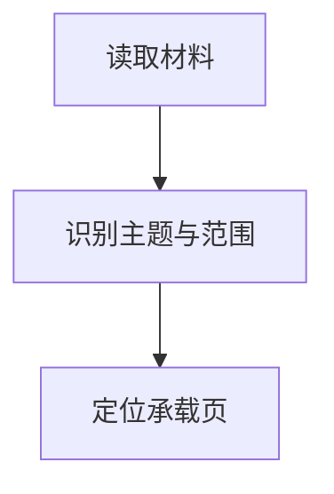

# Craft 共用块格式与能力核验

使用原生样式、结构化块或复杂嵌套时读取。Archive、XV、Car 共用实现方法；连接与凭据仍由各自 skill 的 `craft-api.md` 管理，空间与授权取自执行入口。执行与恢复遵守 [写入协议](write-protocol.md)。

## 能力与写入方式

当前工具 schema/只读帮助优先，其次是当前官方 API 输入契约，最后才是本文示例。截图证明界面功能，不证明当前连接支持写入；读取响应里出现某字段，也不能单独证明更新支持该字段。

普通段落可用 Markdown；要求原生属性时选支持的 Craft Markdown 扩展或结构化 JSON，不能以加粗标题、emoji 方框或图片冒充原生块。批量块使用一次数组提交并保留返回 ID，避免逐块调用。

使用命令式 Craft connector 时，可先读取 `blocks add --help; blocks update --help`，以执行时帮助为准。已核实的入口包括 `--markdown` 和 `--json`；命令参数与 HTTP JSON 字段不是同一套语法，不可互抄。

## 标题、强调、颜色与折叠

- 原生标题/说明通过当前工具的 `textStyle` 或 Markdown/`<caption>` 表达；页面标题由建页操作设置后，正文不重复添加同名大标题。
- 2026-10-29 在 Car Windows 客户端先点击“焦点”，MCP 回读为 `decorations:["quote"]`，再由 MCP 更新同一装饰及颜色，确认显示左侧竖线；“块”对应 `decorations:["callout"]`，显示背景框。需要自己的摘要强调时优先 JSON 明确装饰；Markdown `>` 同样输出 quote，但真实引文的来源语义仍须另行判断。不要猜 `focus` 字段。
- 局部高亮与整块颜色用途不同：如 `<highlight color="gray">待确认术语</highlight>` 只强调短语。颜色应配合文字含义，继承目标页配色。
- 引述内容保留出处；`quote` 只是样式字段，不是来源证明。导出 Markdown 后易被读作引文，自己的强调应保留“提示/结论”等明确标签。
- 折叠先验证标题和下属内容的归属。命令式 connector 当前可用如下 Markdown；实际换行、缩进与子项结构必须保留，不能传字面量反斜杠 n：

```markdown
+ 补充示例与来源
  - 第一条补充说明
  - 第二条补充说明
```

折叠下普通齐左文本可能落成同级块而产生空折叠；复杂内容优先用已支持的结构化层级。写后核对 `listStyle` 和下属块/缩进关系。不要把必要风险、关键条件或必做步骤折叠隐藏。

## 页面、卡片与原生块

嵌套页面可使用：

```markdown
<page textStyle="card" cardLayout="small">
<pageTitle>子主题</pageTitle>
<content>
这里是有独立阅读价值的正文。
</content>
</page>
```

small/square 适合并列入口，regular/large 适合全宽入口，按目标设备与现有风格选择。创建后立即读取返回的 page 块，确认正文在该页自己的非空 `content` 中，父页同级文本不算成功。卡片不是装普通段落的装饰盒。

上句是当前 MCP **写入值**的实测效果，不能反向套用所有读回结果。Windows 卡片配置有五种规格：第 2/3/4/5 种分别由 `small/square/regular/large` 写入得到；第 1 种在 UI 设置后也回读为 `regular`，与第 4 种读回相同。不要仅凭此字段判断实际外观，更不要无差别回写以“保留样式”；第 1 种目前只验证 UI 设置。

实测还发现：对第 1 种＋表情预览的卡片提交 `markdown` 新标题和 `textStyle:"card"`（即使省略 `cardLayout`），会变成第 4 种并丢失表情预览。因此“只提交部分字段”也不保证隐藏样式保留；不要给 UI 定制卡片机械附加 `textStyle`。仅修改标题的其他写法尚未独立验证，优先在 UI 局部编辑并回看；批量操作先用隔离样本确认。普通文本的保样式规则不可直接套到 page/card。

普通卡片预览（标准、表情、书本、便笺、图库、无预览）不等同 Collection gallery 的 `preview-type`。本次 MCP 帮助未给出普通卡片预览写入字段，UI 改表情后回读也未暴露对应属性；目前通过 UI 完成并视觉核验，不能编造 JSON 字段或把 API `contentPreview` 当成视觉预览。第一种规格的可用预览少于其他规格，以面板为准。

结构化块示例（仍需核对当前写入 schema）：

```json
{
  "blocks": [
    {"type":"text","textStyle":"h2","markdown":"检查方法"},
    {"type":"text","decorations":["callout"],"color":"#2563EB","markdown":"**方法：** 按下列步骤核对原始资料。"},
    {"type":"line","lineStyle":"light","markdown":".--"}
  ],
  "position":{"position":"end","pageId":"verified-page-id"}
}
```

相对定位用已核实的 sibling ID。向 text 块添加子内容可能使其转为 page，不能为缩进或装饰无意改变层级。表格用于对照，Collection 的字段、记录和视图应通过对应工具创建；读回的 `<collection>` 等输出标记不能直接作为创建输入。

## Mermaid、公式与代码

Mermaid 优先使用原生可编辑图表。支持时用 Mermaid 围栏；结构化形式按实时输入契约选择 code 块及 `language: mermaid`、`rawCode`。不要把整个带围栏字符串再次塞进 `rawCode`。



这是归档流程示例，不是汽车项目事实。Craft 仅支持 Mermaid 的部分图形类型；2026-09-27 官方文档列出流程、时序、状态、类、ER、XY，未支持的 mindmap/Gantt 等不能凭通用 Mermaid 经验写入。遇到语法或类型不兼容，先简化到受支持表达；需要自由布局时读取已安装的白板 skill。

公式使用原生 TeX；API Markdown 扩展记载 `$...$` / `$$...$$`，结构化入口可能使用 code/math_formula。编辑器键盘快捷输入与 API Markdown 解析不是同一接口，须核实最终是行内还是独立公式。保留符号、单位、上下标和条件；不能仅靠公式美化猜补项目参数。

代码块为真实代码、命令或报文选择适当语言，行内代码用于标识符。图表、公式、代码回读时验证类型、语言和源内容；可用时在页面上确认渲染。只核对源文本不能宣称图表已正确显示。

## 页面级样式

默认继承既有风格。有实际视觉用途且属于当前授权时才调整封面、背景、字体或主题；不扩大成整个空间改版。

2026-09-27 的命令式连接帮助提供页面主题、字体、文字/背景色、封面、backdrop 和分隔样式入口；其他连接可能不同，先查当前帮助。可通过只读的 `blocks explore-themes` / `blocks explore-washi` 查实际可用选项，不编造主题 ID。块字体枚举与页面样式的字体参数应分别核实。

样式更新应只提交需要修改的字段；应用整套主题可能替换或清除主题管理的背景/卡片属性，先保存现状。不要沿用“Craft API 一律不能设置背景封面”的旧结论，也不要从界面推断所有连接都支持它们。

实测 `--bg-color "#EFF6FF #172554" --text-color "#172554 #EFF6FF"` 回读为 `styling.backgroundColor/textColor`，改变子页底色及卡片内的内容缩略图；**不是卡片外壳的自定义背景**。`backdrop` 与 `cover` 也各有对象，不为实现卡片背景盲目套用。常规块的 `color` 在无装饰、quote、callout 上表现不同，不能把十六进制值直接当最终背景色。当前连接会生成 `colorDark`，精确复用时保留两者。

## 合集视图

通过 `collections create/schema/items-*` 管理一份记录，通过 `views-create/update/set-active` 添加表格、图库或 Kanban 视图；不为不同视图复制数据。先读取帮助与 schema，标题列使用返回的 item-name 键，普通属性使用准确键。中文字段在本次连接中曾生成空字符串键，不能自行推断英文键或忽略它。

2026-10-29 已实测在同一 Collection 创建 table/gallery/kanban 三视图。Kanban 使用已有单选状态字段 `--group-by`；视图读回为存在不代表已看到实际布局，验收需切换并观察。普通表格不是 Collection，不用视图命令修改普通表格。

扩展既有 schema 前保存字段、选项、记录和视图。`schema-update` 替换普通字段列表，必须保留全部旧字段；保留单选字段且不改选项时，当前 MCP 简写省略 `:options` 可保留选项与颜色。新增字段后重新读取 schema：2026-10-30 实测标题键由 `_9` 变为 `_10`，新增“相关知识”占用 `_9`；不能缓存标题键或仅凭显示名猜键。写后逐项比对旧记录、字段值、单选颜色和视图筛选，新增字段不能导致旧值丢失。

## 知识链接与反向引用

先区分三种对象，再依实时帮助选择实现：

| 对象 | 用途 | 当前能力边界 |
| --- | --- | --- |
| 正文内部链接 | 记录说明中引用已有页面、段落或其他记录 | Markdown `[描述](block://实际块ID)`；合集记录本身是可含正文的页面，使用 `blocks add --id <itemId>` |
| `blockLink` 字段 | 表格内提供一个主要知识入口 | 当前 MCP 可新增字段并写入目标 ID；2026-10-30 已验证产生反向引用，不等同普通 URL 字段 |
| `relation` 字段 | 两个合集之间的结构化关系 | 当前 MCP 可保留并更新已有关系值，不能新建或重新指定关系目标；须先通过界面配置。不得用块链接冒充关系字段 |

链接检索的触发与同批复用按[共用内容流程](content-workflow.md#关联检索按需触发同批复用)执行。目标 ID 已明确时直接读取当前空间中的目标，不强制先搜索；知识页核实相关正文与上下文，记录页结合属性、所属合集与必要正文核实，不因正文为空排除有效记录。排除不可访问、无足够信息或仅名称相似的目标；正文链接、字段链接及关系字段都不证明工程适用性。当前已验证一个块链接字段保存一个目标；不要猜数组格式。多个资料的承载先按[排版规范的内容边界](craft-presentation.md#合集字段记录正文与独立知识页)判断，可用补充链接属性或确有阅读用途的正文，不因接口限制自动创建正文或中转页。迁移既有正文时先将有效说明、条件和链接保存到新承载位置并回读核验，再移除已迁移块；保留记录 ID 与外部引用，不能删除整个记录来消除纸张图标。

### 可读标签与官方 API 回退

2026-10-30 实测 MCP `items-update --相关知识 <blockId>` 能建立真实引用，但将 ID 本身存成显示标题，Windows 界面也显示 ID。当前命令帮助未暴露标签参数；不要将该结果作为成品，也不要向标量参数塞入未经支持的 JSON。

当该命名能力在当前 MCP 不可用时，可按执行 skill 的连接规则使用同一空间独立配置的官方 API，或通过 UI 设置。先 `GET /connection` 核实空间，保存记录快照，再用 `PUT /collections/{collectionId}/items` 局部更新。2026-10-30 已实测下列请求形状；属性键、条目与目标 ID 均须实时取得：

```json
{
  "itemsToUpdate": [
    {
      "id": "verified-item-id",
      "properties": {
        "live-block-link-property-key": {
          "title": "方法名称（适用范围）",
          "blockId": "verified-target-id"
        }
      }
    }
  ]
}
```

回读值为 `{title, reference:{blockId}}`，与输入的扁平 `blockId` 不同；不要照抄读取形状当输入。只改关联属性，保留其余值。用户没有授权复制知识或改变原分类时，不因建立链接而重写原始字段。自定义显示标题应简短可读；未验证目标改名会自动更新标签，维护时复核。

### 双向核验

- 读取字段或正文，核对可读标题、准确目标 ID、保存位置和原字段未变；有分页就读全所需记录。
- 用 `internal-links get --level block --from-document <rootBlockId> --include-self-links` 核对来源，用 `--to-document <targetRootBlockId>` 核对反向引用。嵌套页同处一个根文档时需要 `--include-self-links`，否则默认排除；根文档 ID 与编辑 URL 的 documentId 不可混用。跟随分页，按 `sourceBlockId` 与 `targetBlockId` 精确比对，不能只看总数。
- 正文内部链接和 `blockLink` 字段的引用可由以上接口验证；合集 `relation` 不在该接口结果中，需回读两侧关系值，异步同步时先重读，不手工重复建反向关系。
- 桌面验收至少走通一条“记录字段 → 知识页 → 页底‘链接到此页面’ → 原记录”的路径；来源分组可能需要展开。可访问性树会列出屏幕外元素，先滚动到可见区域再点击；异步过渡帧不能当最终页面。只读接口验证时如实说明未测试 UI。
- 反向引用是返回入口，不是目标页里新增一段镜像正文；不为制造双向外观在两边重复写链接。不保证正文同步、跨空间反链或检索自动穷举全部关联。

2026-10-30 Car 实测：块链接字段可生成精确到合集记录的反向引用；Windows 已走通“记录 → 知识页 → 反向引用 → 原记录”。随后将简短关联说明迁入文本属性、两个补充正文链接迁入块链接属性，保留 59 条记录 ID 和旧属性，10 个字段引用均通过正向/反向核验；移除已迁移的正文后，Windows 表格的正文图标消失，字段引用仍有效。反向引用不依赖记录正文存在。可读标签由官方 API 写入并在 UI 验证；此次未实测新建合集关系、双向关系同步、目标改名/删除后的行为、跨空间及移动端。

## 更新、附件与验证

- 更新前保存原文和必要属性。当前 `blocks update --markdown` 的多段输入会用第一段替换目标块、把其余段落插成同级块；不能把整篇正文传给一个标题块而期待原层级自动保留。
- 样式更新优先采用受支持的局部字段。仅当实时 schema 要求时连同原 markdown 提交；不得为了改样式意外重写、清空或复制正文。
- 图片传真实 MIME 字节并回读为 image；附件应可追溯且实际存在，原图与图注顺序正确。上传位置、嵌套页和返回块 ID 均按当前连接契约核实。
- 写后回读目标内容，检查文字、单位、来源、层级、颜色、强调、折叠归属、卡片子内容、图表类型、媒体顺序与重复项。核对实际路径，处理超时与恢复按共用协议。
- 可用时打开目标页确认重要视觉效果；只有结构回读时，明确未验证渲染。样式降级必须说明，不能把保存成功等同于达到排版要求。

## 依据

### 2026-10-29 Car 实测边界

环境：专用 `craft-car` MCP、Car 空间核验通过、Windows Craft 浅色界面。测试页：[Craft 排版实测](https://docs.craft.do/editor/d/d3ce535e-6a99-0e82-fd03-a42f4ae471a0/a02c8800-b728-62c7-459f-94587a150c99)。页面是演示材料，不作为工程知识来源；其存在不是未来归档的必要依赖。

| 项目 | 实测结果与可用方式 |
| --- | --- |
| h1/h2/h3/h4/body/caption | MCP 创建后回读并在桌面看到层级；body 可能省略默认 `textStyle`，不据此判失败 |
| 焦点、块、五种语义色 | UI 焦点→回读 quote→MCP 更新颜色→UI 竖线验证；callout 五色背景均可见，深色模式只读到自动变体，未视觉验收 |
| 子页面、卡片正文 | 回读非空 content，并打开 small 子页检查正文；不是父页同级文本 |
| 五种卡片规格 | 第 2–5 种由 MCP 创建并视觉确认，第 1 种用 UI；第 1 种与第 4 种回读 regular 重名，存在读写不对称 |
| 卡片预览 | 标准、表情已保存并显示；书本、便笺、无预览在配置面板切换观察，最终书本保存；图库无图片时显示空白占位，未验证实际多图呈现 |
| 卡片外壳背景 | UI 设置蓝色纯色背景并保存；MCP 回读未暴露该外壳背景和书本预览配置，不能从已有 styling 字段完整重建；图片/渐变背景未实测 |
| 页面底色 | MCP 设置浅/深色配对并回读，浅色内容缩略图变化可见；不等于卡片外壳背景 |
| 折叠、普通表格 | UI 展开后看到缩进条目，普通表格内容和顺序正确 |
| 分隔线、分页符 | extraLight/light/regular/strong/pageBreak 创建回读及桌面外观通过；未做 PDF/打印分页验证 |
| Collection | 两条记录共享 table/gallery/kanban 三视图，MCP 创建并在 UI 切换观察；图库样本无实际图片 |

此次未重测文件二进制上传、图片上传、TeX、Mermaid、白板、封面、字体组合、移动端与深色模式。其使用规则仍有效，能力状态按各自工具与独立验证判断；不能把本次结果扩大为“所有插入功能均通过”。UI 预览存在异步渲染，点击后必要时再次观察，不能把过渡帧当最终样式。只读 API 未显示预览属性不等于整个 Craft API 永久不支持；新的工具契约出现时再核验。

2026-09-27 核对 [Craft Space API](https://connect.craft.do/api-docs/space)、[Mermaid 文档](https://support.craft.do/en/write-and-edit/mermaid-diagrams)、[公式文档](https://support.craft.do/en/write-and-edit/math-formulas) 及本次可用 Craft connector 的 `blocks add/update --help`。这些是功能依据；本文的内容选择与视觉取舍是本地规范。执行时仍核实实时接口。
